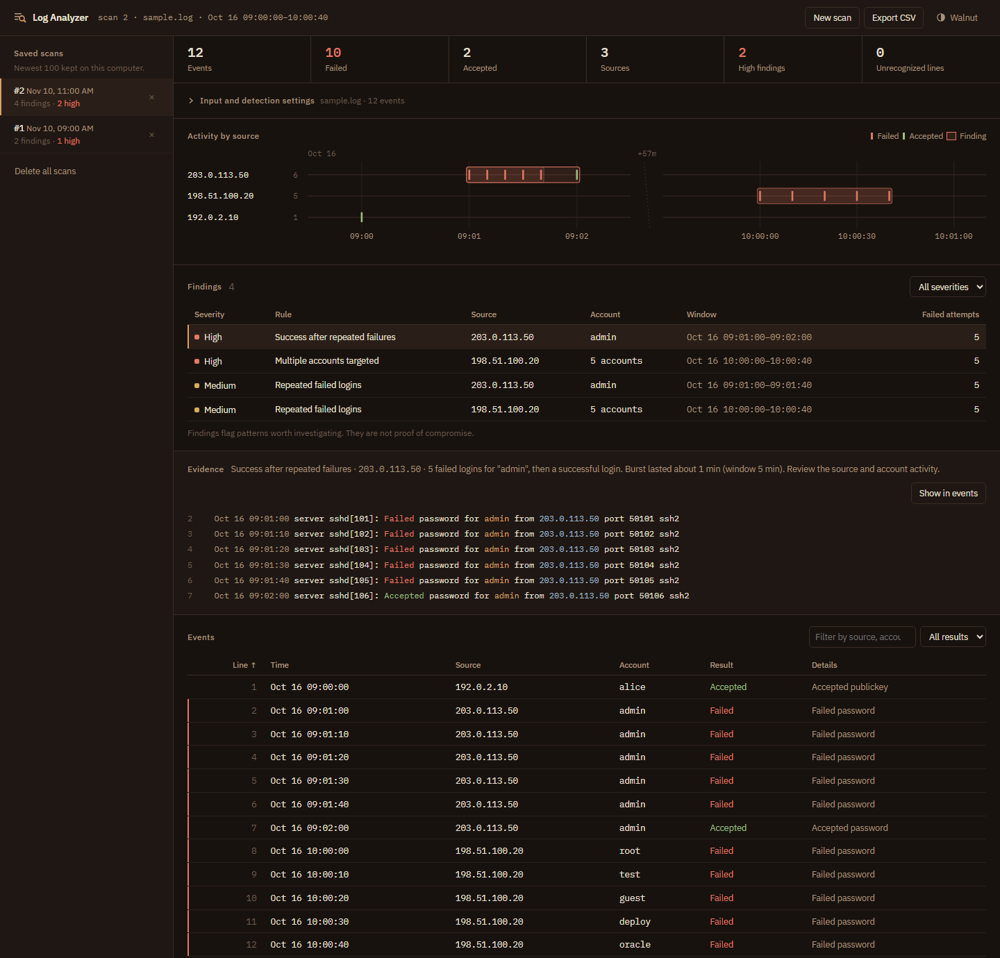
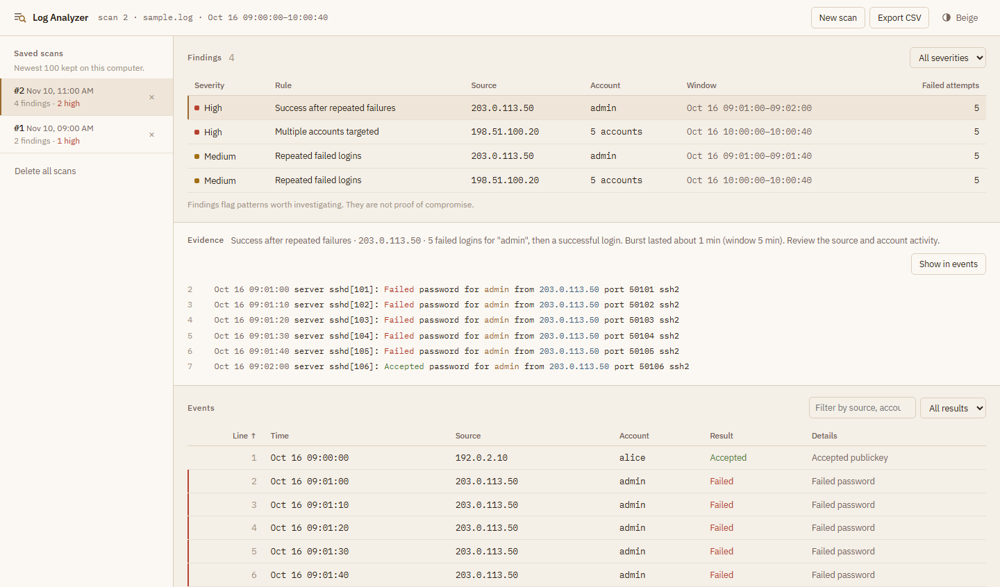

# Security Log Analyzer

A Python portfolio project with a local browser dashboard and SQLite storage. No additional packages are required.

## Start

Double-click Start.bat, then select **Load sample logs** in the browser. Keep the console open while using the app. Stop with Ctrl+C. Alternatively run `python app.py` from this folder. The app uses http://127.0.0.1:8501, or the next free port up to 8510 if 8501 is busy.

## Features

- Upload, drag and drop, or paste Linux SSH authentication logs.
- Recognizes `Failed`/`Accepted` lines for password, public key, and keyboard-interactive logins, plus `Invalid user`, PAM `authentication failure`, and `Connection closed ... [preauth]` lines. Several lines describing the same attempt (same sshd PID) are counted once.
- Detects repeated failures, multiple accounts targeted, and a successful login after failures against the same account. Each rule has its own threshold and all rules share a rolling time window.
- Raises one alert per attack burst, with start and end time, accounts involved, and the number of failed attempts.
- Allowlist IP addresses or CIDR ranges (for example your own network) to leave them out of detection.
- Activity timeline with one lane per source IP: failed and accepted logins as tick marks, findings as highlighted bands, and long quiet gaps cut out so separate bursts stay readable.
- Findings table with a severity filter. Select a finding (click, or use the arrow keys and Enter) to see its evidence with the time, result, account, and source IP colour-coded, then **Show in events** to filter the event table to those lines.
- Sortable, paginated event table with search and result filters.
- CSV export of findings including evidence lines. Cells that would run as spreadsheet formulas are escaped.
- Saves each analysis locally in SQLite, listed in the sidebar. Reopen, delete one, or delete all saved scans. The newest 100 scans are kept.
- Walnut (dark) and beige (light) themes using IBM Plex Sans and Mono. Your theme choice is remembered in the browser.

## Scope

Supports traditional syslog timestamps (select the year of the first line) and ISO timestamps. ISO timestamps with an offset or `Z` are converted to UTC; timestamps without an offset are used as written. Syslog logs that cross from December into January move to the next year automatically. Unrecognized lines are counted and skipped. This is an educational rule-based prototype; alerts require investigation. Sample IP addresses are documentation examples.

Uploaded logs and analysis results stay on this computer. The only outside request is for the IBM Plex font files from Google Fonts; offline, the page falls back to system fonts. The database contains original log lines; use **Delete all** in Saved scans, or remove analysis.db while the app is stopped, to clear them.

## Project files

- app.py: local HTTP server and SQLite persistence
- index.html: the dashboard (HTML, CSS, and plain JavaScript)
- analyzer.py: parser and detection rules
- sample.log: synthetic demonstration data
- test_analyzer.py, test_history.py: tests (`python -m unittest -v`)

## Demonstration

1. Start the app and click **Load sample logs**.
2. Confirm the cards show **12 events, 10 failed, 2 successful, and 2 high-severity alerts** (4 alerts overall).
3. The **Success after repeated failures** finding is selected. Its evidence shows five failures and then the successful login. Click **Show in events** to filter the event table to those lines.
4. Click **New scan**, change **Failed logins per IP** to 3, add `203.0.113.50` to the allowlist, and click **Analyze** to save a second scan. Findings for that IP disappear.
5. Click the first scan in the **Saved scans** sidebar. Its settings and results are restored.
6. Click **Export CSV** to download the findings.
7. Use the theme button in the top right to switch between walnut and beige.

## Detection examples

| Rule | Default trigger within 5 minutes | Sample result |
| --- | --- | --- |
| Repeated failed logins | At least 5 failures from one IP | Medium alerts for 203.0.113.50 and 198.51.100.20 |
| Multiple accounts targeted | At least 5 distinct usernames failing from one IP | High alert for 198.51.100.20 |
| Success after repeated failures | A success after at least 5 failures from the same IP against the same user | High alert for admin from 203.0.113.50 |

An alert keeps growing while matching events continue within the window. After a quiet gap longer than the window, the next match starts a new alert. Failures can have benign causes; successful login after failures is a signal for investigation, not proof of account compromise.

## Security notes

- **Source IP spoofing.** sshd writes the username an attacker typed into the log as-is, spaces included. A username such as `x from 10.0.0.1` could make a naive parser blame the wrong IP. The parser always takes the IP from the end of the line, where sshd writes it, and validates it with Python's `ipaddress` module.
- **Local server hardening.** The server listens on 127.0.0.1 only and rejects requests whose `Host` or `Origin` header is not this app. That blocks DNS-rebinding and cross-site requests from websites open in the same browser. POST requests must be JSON.
- **CSV injection.** Exported cells starting with `=`, `+`, `-`, or `@` are prefixed with `'` so spreadsheets show them as text.

## Screenshots

Both use the supplied synthetic sample logs.

Walnut theme: summary counts, activity timeline per source IP, findings, evidence, and events.

Beige theme: the selected finding's evidence with time, result, account, and source IP colour-coded.

## Architecture

Browser dashboard (index.html) → Python HTTP server (app.py) → SSH parser and rolling-window rules (analyzer.py) → SQLite.

The browser renders summary cards, charts, and evidence using plain JavaScript. Python handles analysis and persistence using only the standard library. Summary counts are stored in their own columns so the history list loads without reading every saved result.

| Endpoint | Purpose |
| --- | --- |
| `POST /analyze` | Analyze logs and save the scan |
| `GET /history` | List the newest 100 scans |
| `GET /history/{id}` | Reopen one scan |
| `DELETE /history/{id}` | Delete one scan |
| `DELETE /history` | Delete all scans |

## Validation

Run `python -m unittest -v` from this folder. Tests cover sample detections, time-window separation, account matching, unrecognized input, IP spoofing through usernames, extra log formats, duplicate-line handling, timezone conversion, year rollover, burst alerts, per-rule thresholds, the allowlist, history persistence and retrieval, legacy records, deletion and pruning, invalid settings, and rejection of foreign hosts and origins. Persistence tests use a temporary database.

## Troubleshooting

After code changes, stop the app with Ctrl+C, answer Y if Windows asks to terminate the batch job, run Start.bat again, then refresh the browser with Ctrl+F5. Keep the terminal running. Use http://127.0.0.1:8501, with http rather than https.

Start.bat uses the project's .venv if present, otherwise the `py` launcher or `python` on PATH. Python 3.10 or newer is required. No pip packages are required.

## Portfolio description

Built a Python security log analyzer that parses SSH authentication events, detects suspicious login patterns using configurable rolling windows, and presents supporting evidence in a browser dashboard. Hardened the parser against log-injection IP spoofing and the local server against DNS rebinding and cross-site requests. Added burst-based alerts, per-rule thresholds, an allowlist, activity charts, CSV export, light and dark themes, and SQLite scan history.

## Future improvements

Additional log formats (for example Windows Security events), GeoIP or reputation lookups for source IPs, and streaming analysis for very large files. This version is a local educational prototype, with no live collection or automated response.
